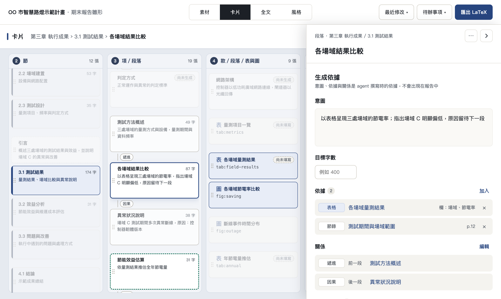
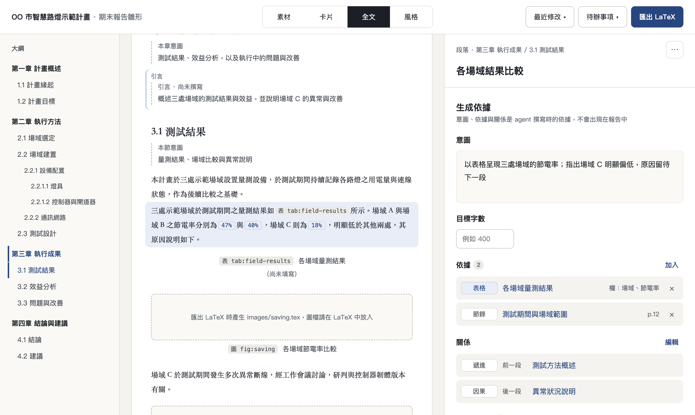

# Knot

與 Agent 協作撰寫報告。

Knot 是一個寫報告用的白板服務，讓使用者和 agent（例如 Claude Code）一起規劃、撰寫同一份報告。名稱取自英文 knot（繩結）：把素材、事實與段落之間的關係一個個繫起來，結成一份前後連貫的報告。

寫一份長篇報告，難的不只是寫出每一段，而是先想清楚整份報告的結構：分哪幾章、每一段要說什麼、段落之間怎麼承接、引用的數字從哪裡來。Knot 把報告攤開成一張張卡片，每張卡片是一個標題或一個段落，記著它的意圖、依據的素材，以及和其他段落的關係。agent 透過 MCP 在白板上建立與修改卡片，使用者在瀏覽器裡即時看到同一塊白板，可以直接調整，也可以在卡片上留言交代 agent。雙方對著同一份結構討論，而不是在對話紀錄裡來回貼文字。

分工上：

- **agent 負責需要判斷的事：** 讀原始資料、節錄素材、規劃結構、寫每張卡片的意圖、撰寫本文。
- **Knot 負責需要保證的事：** 素材記下出處、事實的值必須出現在素材中、結構合法、每次修改都可以檢視與復原。
- **使用者在畫面上檢視與調整：** 卡片樹、全文與編輯區，並以卡片上的留言與待辦事項把意見交代給 agent。





Knot 本身不呼叫任何 LLM API，也不保存金鑰。

> **資料外送：** agent 讀到的素材與卡片會送到 agent 所用的模型服務，Knot 無法把關。哪些資料可以交給 agent 處理，請自行判斷。

## 需要準備

- [Docker Desktop](https://www.docker.com/products/docker-desktop/)（或其他 Docker 環境）
- [Claude Code](https://claude.com/claude-code)
- [Git](https://git-scm.com/)（下載原始碼用；沒有 Git 也可以從 [Releases](https://github.com/nics-dp/knot/releases) 下載原始碼的 zip）

支援 Mac（M 晶片）與 Windows（Intel／AMD 處理器）。**不需要安裝 Java、Clojure 或 Node**：建置與執行都在 Docker 容器裡完成。

## 安裝（第一次）

### 1. 建置 Knot 的映像

從原始碼建置：

```sh
git clone --branch v0.1.0 https://github.com/nics-dp/knot.git
cd knot
docker build -t knot:0.1.0 .
```

`--branch v0.1.0` 指定版本。第一次建置要下載基底映像與套件，需要網路，約 5–10 分鐘；之後重新建置會快很多。完成後就有名為 `knot:0.1.0` 的映像，下面的指令都用這個名稱。

<details>
<summary>另一種方式：從 GitHub 映像庫下載建好的映像（需要權限）</summary>

已取得 `ghcr.io/nics-dp/knot` 套件存取權限的帳號，可以直接下載建好的映像，不必自己建置。到 GitHub 的 [Personal access tokens（classic）](https://github.com/settings/tokens) 建立一個權杖，權限只勾 `read:packages`，然後：

```sh
docker login ghcr.io -u <你的 GitHub 帳號>
# Password 貼上剛建立的權杖；登入一次即可，Docker 會記住
docker pull ghcr.io/nics-dp/knot:0.1.0
docker tag ghcr.io/nics-dp/knot:0.1.0 knot:0.1.0
```

同一個版本同時包含 Mac（M 晶片）與 Windows 兩種，Docker 會自動下載符合你電腦的版本（約 230 MB）。最後一行把它取名為 `knot:0.1.0`，下面的指令就能照用。skill 請從 [Releases](https://github.com/nics-dp/knot/releases) 下載 `knot-skills-0.1.0.zip`，解壓縮後用其中的 `knot-*` 資料夾（見第 3 步）。

</details>

### 2. 讓 Claude Code 連上 Knot

```sh
claude mcp add --scope user --transport http knot http://localhost:3000/mcp
```

只要設定一次，之後在任何目錄開 Claude Code 都會連到正在執行的 Knot。

### 3. 安裝 skill

skill 是給 agent 的操作說明，告訴它如何規劃、匯入、撰寫與處理待辦，放在原始碼的 `skills/` 目錄。在第 1 步的 `knot` 目錄執行，把它們複製到 Claude Code 的 skill 目錄：

```sh
mkdir -p ~/.claude/skills
cp -R skills/knot-* ~/.claude/skills/
```

Windows（PowerShell）：

```powershell
New-Item -ItemType Directory -Force "$HOME\.claude\skills"
Copy-Item -Recurse -Force skills\knot-* "$HOME\.claude\skills\"
```

只想用在某一份報告時，也可以放在該報告目錄的 `.claude/skills/`。skill 與 Knot 要同一個版本。

| skill | 用途 | 對 agent 這樣說 |
|---|---|---|
| `knot-planning` 規劃 | 讀原始資料，和你討論後寫成報告目錄裡的 `撰寫要求.md`（必須涵蓋的內容、架構草案、待確認的問題）；你確認後，依它在 Knot 建立章節、段落與每段的意圖 | 「開始規劃報告」「依撰寫要求建立卡片」「撰寫要求改了，調整大綱」 |
| `knot-import` 匯入 | 從原始資料照抄節錄與表格成為素材，把本文要寫的數字記成事實，再把素材掛到需要它的段落 | 「匯入資料」「新增了一份資料，幫我匯入」 |
| `knot-writing` 撰寫 | 依撰寫順序逐段寫本文，寫完一節就回頭審稿 | 「開始撰寫全文」「寫第二章」「重寫這一節」 |
| `knot-todos` 處理待辦 | 回覆你已回答的提問、處理你交代的待辦，以及段落修改後 Knot 留下的待辦 | 「處理待辦」「繼續下一輪」 |

## 開始一份報告

### 1. 準備報告目錄

一份報告一個目錄。建一個新目錄，把原始資料（計畫書、會議紀錄、數據、格式規定等）放進去：

```
共享單車成果報告/
├── 計畫書.pdf
├── 期中審查會議紀錄.pdf
└── 營運數據.csv
```

### 2. 啟動 Knot

在報告目錄執行（macOS、Linux）：

```sh
cd 共享單車成果報告
docker run --rm -p 127.0.0.1:3000:3000 -v "$PWD":/report --user "$(id -u):$(id -g)" knot:0.1.0
```

Windows（PowerShell）：

```powershell
cd 共享單車成果報告
docker run --rm -p 127.0.0.1:3000:3000 -v "${PWD}:/report" knot:0.1.0
```

用瀏覽器開啟 http://localhost:3000，會看到一份空白報告。這個終端機視窗要一直開著；按 Ctrl+C 停止。

Knot 會在報告目錄裡建立 `knot-data/` 資料夾存放報告內容（卡片、素材、事實、留言與歷程），下次在同一個目錄啟動就會接著用。請不要手動修改或刪除裡面的檔案。

### 3. 和 agent 協作

另開一個終端機，在同一個報告目錄啟動 Claude Code，依序請它：

1. **「開始規劃報告」**：agent 讀完資料，寫出 `撰寫要求.md` 並列出要你決定的問題。你可以在對話中回答，也可以直接修改這個檔案。確認後它會在 Knot 建立章節、段落與每段的意圖。
2. **「匯入資料」**：agent 把資料中要引用的段落、數據表與數字登記成素材與事實，並掛到需要它的段落。建議到 Knot 的「素材」頁抽查幾筆原文與來源。
3. **「開始撰寫全文」**：agent 依每段的意圖、素材與前後段落寫出本文。
4. **之後每一輪：** 你在 Knot 上修改、留言或留下待辦，再請 agent「處理待辦」。

agent 的修改會即時出現在瀏覽器上（剛修改的卡片有綠框）。每一次修改（你的或 agent 的）都記在卡片歷程裡，可以和前一版比較，也可以按 Ctrl+Z 復原。

### 4. 匯出 LaTeX

頂部列的「匯出 LaTeX」會下載一個 zip：`main.tex`（範例主檔，以 XeLaTeX 編譯）、`contents/`（每章一個檔）、`tables/`（每張表一個檔）、`images/`（每張圖一個檔，圖檔請自行放入，說明見 `images/README.txt`）。這是草稿：內容與章節、表、圖之間的插入關係都已接好，排版細節請在 LaTeX 中調整。重新匯出會覆蓋這些檔案，自己的修改請放在 `main.tex` 或另外的檔案。

## 日常使用

- **停止：** 在執行 Knot 的終端機按 Ctrl+C。報告內容都在報告目錄的 `knot-data/` 裡。
- **換一份報告：** 停止後，到另一個報告目錄再啟動一次。同一時間只開一份報告。
- **備份或搬移：** **先停止 Knot**，再把整個報告目錄（含 `knot-data/`）複製或搬到別處；在新位置啟動就能接續編輯。執行中複製可能得到不完整的資料。原始資料最好一起搬，agent 補匯入或核對時要用到。同一份報告不要複製成兩份各自編輯，兩份之後無法合併。
- **更新版本：** 先停止 Knot，備份報告目錄的 `knot-data/`。在 `knot` 原始碼目錄取得新版本並重新建置（以 0.2.0 為例）：`git fetch --tags`、`git checkout v0.2.0`、`docker build -t knot:0.2.0 .`，再重新複製 `skills/knot-*` 取代 `~/.claude/skills/` 裡舊的（skill 與 Knot 的工具一起改版，兩者要同一個版本）。之後啟動時改用 `knot:0.2.0`。用映像庫的人改為 `docker pull`、`docker tag` 新版本，並下載同版本的 skill zip。
- **3000 被佔用時：** 把指令中的 `127.0.0.1:3000:3000` 改成例如 `127.0.0.1:3100:3000`，瀏覽器改開 http://localhost:3100，Claude Code 的 MCP 網址也要改成 `http://localhost:3100/mcp`。（啟動訊息印的 `localhost:3000` 是容器內的 port，不用理會。）

啟動指令的各部分：

| 參數 | 說明 |
|---|---|
| `-p 127.0.0.1:3000:3000` | 讓本機瀏覽器連得到容器內的 Knot。**一定要寫 `127.0.0.1:`**，否則同網段的其他電腦也連得到你的報告。 |
| `-v "$PWD":/report` | 把目前所在的目錄當成報告目錄。 |
| `--user "$(id -u):$(id -g)"` | 讓 `knot-data/` 屬於你自己的帳號（Linux 上省略時會屬於 root；Windows 不需要）。 |
| `--rm` | 停止後自動刪除容器；報告內容在報告目錄裡，不受影響。 |

## 常見問題

- **`docker build` 失敗：** 多半是下載套件時連不上網路（Docker Hub、Maven、npm）。確認網路與 proxy 設定後重新執行；已下載的部分會沿用。
- **`docker pull` 顯示 denied 或 unauthorized：** 映像庫需要權限。確認已用有 `read:packages` 權限的權杖 `docker login ghcr.io`，而且你的 GitHub 帳號有這個套件的存取權；沒有的話請改從原始碼建置。
- **瀏覽器打不開：** 確認啟動 Knot 的終端機還開著、沒有錯誤訊息，或用 `docker ps` 看容器是否在執行；也確認網址的 port 和 `-p` 設定一致。
- **Claude Code 說找不到 knot 工具：** 確認 Knot 正在執行，並用 `claude mcp list` 檢查 MCP 設定的網址。Knot 要先啟動，Claude Code 才連得上。
- **agent 沒有照 skill 的流程做：** 確認 `~/.claude/skills/` 底下有 `knot-planning` 等資料夾（每個資料夾裡有 `SKILL.md`）；剛安裝時要重新開啟 Claude Code 才會載入。
- **MCP 回應 403：** Knot 只接受來自本機的請求，從其他主機名稱開啟的網頁無法呼叫。

## 參與開發

上面的安裝只需要 Docker。要修改 Knot 本身時，本機才需要 JDK 25、Clojure CLI、Node 與 Babashka；開發環境、測試與發佈流程見 `CLAUDE.md` 與 `docs/SPEC.md`。
